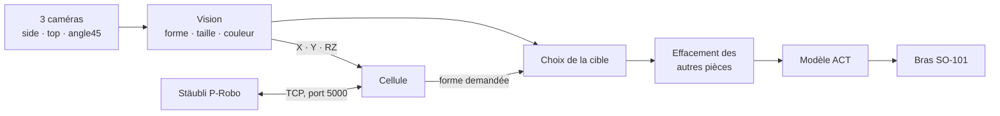
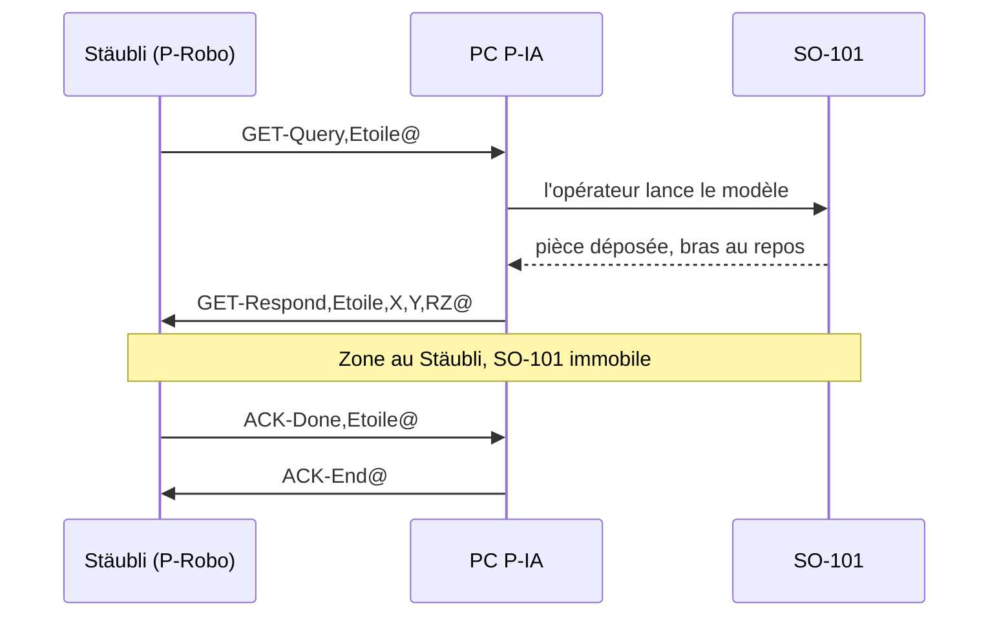

<div align="center">

# 🦾 Cellule de tri P-IA

**Un bras SO-101 trie des pièces par imitation et les transmet à un robot Stäubli**


[Principe](#principe) ·
[Essayer sans matériel](#essayer-sans-matériel) ·
[Installation](#installation) ·
[Au local](#au-local-robot) ·
[Documentation](#documentation) ·
[État](#état-du-projet)

</div>

---

Projet intégré **Robotique & IA** (HELMo). Le pôle IA (**P-IA**) gère la zone d'alimentation : des
pièces (étoile, cercle, triangle, hexagone) y arrivent à des positions aléatoires, certaines
défectueuses. Les pièces conformes sont déposées dans la **zone d'échange**, où le robot du pôle
robotique (**P-Robo**) vient les chercher. Les défectueuses vont à la **poubelle**.

## Principe

Le modèle d'imitation (ACT, LeRobot) a appris avec **une seule pièce visible**. Avec plusieurs
pièces, il vise « le milieu ». La vision choisit donc la pièce à déplacer et **efface les autres**
des images, en les remplaçant par une photo de la table vide.



### Dialogue avec le Stäubli



> [!WARNING]
> Les deux robots ne doivent **jamais** être ensemble dans la zone d'échange. La cellule refuse
> d'envoyer des coordonnées tant qu'un programme LeRobot tourne, mais elle **ne commande pas le
> SO-101** : elle ne peut qu'alerter l'opérateur. Détails : [protocole](docs/protocole_tcp.md).

## Essayer sans matériel

La communication et les tests fonctionnent sur n'importe quel PC Linux, sans caméra ni robot.

```bash
git clone https://github.com/Bixymax/IA_lerobot.git
cd IA_lerobot
python3 -m venv .venv && source .venv/bin/activate
pip install -r requirements.txt
python -m pytest -q                 # tests sur images synthétiques et sockets locales
```

Pour jouer un échange complet, avec des coordonnées fictives :

| Terminal 1 (vision) | Terminal 2 (faux robot) |
|---|---|
| `python echange_tcp.py` | `python scripts/faux_staubli.py` |
| taper `o` (zone libre) | taper `e` (demander une étoile) |
| taper `v` (envoyer les coordonnées) | taper `d` (prise réussie) |

## Installation

### Matériel

| Élément | Détail |
|---|---|
| Bras | SO-101, un *leader* et un *follower* |
| Caméras | 3 Logitech C310 : `top` (dessus), `side` (rasante), `angle45` (oblique) |
| PC | Ubuntu, LeRobot 0.6 |
| Robot P-Robo | Stäubli, relié par câble RJ45 |

### Logiciel (une fois par PC)

Installer d'abord [LeRobot](https://huggingface.co/docs/lerobot/installation) dans un environnement
conda nommé `lerobot`, puis :

```bash
conda activate lerobot
pip install -r requirements.txt pyvirtualcam
sudo apt install v4l-utils v4l2loopback-dkms v4l2loopback-utils
hf auth login                       # jeton Hugging Face, jamais dans le code
```

> [!NOTE]
> Avec Secure Boot, le premier chargement de `v4l2loopback` demande un mot de passe MOK à confirmer
> au redémarrage (voir [flux masqué](docs/flux_masque.md)).

## Au local robot

> [!IMPORTANT]
> Les **index des caméras** et les **ports des bras** changent à chaque installation.
> Les relever à chaque séance dans `local.env`.

```bash
cd ~/projetIArobot && conda activate lerobot
./setup_local.sh                    # contrôle le poste, charge les caméras virtuelles
nano local.env                      # SIDE, TOP, ANGLE45, PORT_FOLLOWER, PORT_LEADER
source local.env                    # dans chaque terminal
```

<details>
<summary><b>1. Bras et caméras</b></summary>

- `lerobot-find-port` : savoir quel port est le leader (débrancher / rebrancher un bras). Les
  calibrations restent valables si les bras gardent les mêmes `id` ([manuel](docs/manuel.md)).
- Vérifier à l'écran quelle caméra est `side`, `top`, `angle45` :

```bash
python masquage.py voir --cams side=$SIDE top=$TOP angle45=$ANGLE45
```

</details>

<details>
<summary><b>2. Fond et calibration</b> (si une caméra a bougé ou si l'éclairage a changé)</summary>

Table vide, bras au repos, dans cet ordre :

```bash
python masquage.py reglages --cams side=$SIDE top=$TOP angle45=$ANGLE45 --out fonds/   # exposition, balance
python masquage.py capture  --cams side=$SIDE top=$TOP angle45=$ANGLE45 --out fonds/   # fond
python calibration.py cliquer --cams top=$TOP side=$SIDE angle45=$ANGLE45              # coins de la nappe
python calibration.py voir    --cams top=$TOP side=$SIDE angle45=$ANGLE45              # contrôle
```

La grille doit coller à la nappe sur les trois vues.

</details>

<details>
<summary><b>3. Pièces conformes</b> (apprentissage des références)</summary>

```bash
python conformite.py apprendre --cam top=$TOP --forme etoile    # puis hexagone, triangle, rond
python conformite.py verifier  --cam top=$TOP                   # pièces conformes et défectueuses
```

Méthode et tolérances : [conformité](docs/conformite.md).

</details>

<details>
<summary><b>4. Faire tourner la cellule</b></summary>

Terminal 1, au choix :

```bash
# demandes du Stäubli (ou du faux robot) : voir docs/essai_cellule.md
python cellule.py --cams side=$SIDE top=$TOP angle45=$ANGLE45

# ou flux masqué seul, pour téléopérer et enregistrer
python flux_masque.py --cams side=$SIDE top=$TOP angle45=$ANGLE45 --forme triangle --apercu
```

Terminal 2, LeRobot sur les caméras virtuelles 10, 11 et 12 :

```bash
source local.env
./scripts/rollout_echange.sh        # tester le modèle, bras au repos
```

Les commandes de téléopération et d'enregistrement sont dans le [manuel](docs/manuel.md).

Réglages de l'effacement (`TEINTES`, `SEUIL_DIFF`, `SEUIL_CHROMA`) : en haut de `masquage.py`. Les
messages `Corrupt JPEG data` sont masqués par défaut (`--verbeux` les réaffiche ; pour LeRobot :
`lerobot-record ... 2> >(grep -v "Corrupt JPEG" >&2)`).

</details>

## Structure du dépôt

| Fichier | Rôle |
|---|---|
| **Vision** | |
| [`masquage.py`](masquage.py) | Réglage des caméras, capture du fond, effacement des pièces |
| [`calibration.py`](calibration.py) | Conversion pixels ↔ millimètres pour chaque caméra |
| [`conformite.py`](conformite.py) | Forme, taille et couleur de chaque pièce, verdict conforme / défaut |
| [`selection.py`](selection.py) | Choix de la pièce montrée, retrouvée sur les autres caméras |
| [`flux_masque.py`](flux_masque.py) | Caméras virtuelles masquées pour LeRobot |
| **Cellule et communication** | |
| [`cellule.py`](cellule.py) | Demande, flux masqué, mesure et réponse (modèle lancé à la main) |
| [`mesure_echange.py`](mesure_echange.py) | Position et orientation de la pièce dans la zone d'échange |
| [`echange_tcp.py`](echange_tcp.py) | Serveur TCP et sécurité de la zone d'échange |
| **Outils** | |
| [`setup_local.sh`](setup_local.sh) | Contrôle du poste à l'arrivée au local |
| [`local.env.example`](local.env.example) | Modèle de `local.env` (non versionné) |
| [`scripts/`](scripts/) | Test du modèle, faux robot, bilan des formes |
| [`tests/`](tests/) | Tests sans matériel |
| [`consignes/`](consignes/) | Cahiers des charges |

## Documentation

| Document | Pour quoi faire |
|---|---|
| [Architecture](docs/architecture.md) | Briques du système et décisions justifiées |
| [Manuel](docs/manuel.md) | Commandes LeRobot : calibration, téléopération, enregistrement, test |
| [Checklist d'enregistrement](docs/checklist_enregistrement.md) | Mise en route avant une séance d'enregistrement |
| [Flux masqué](docs/flux_masque.md) | Caméras virtuelles et dépannage |
| [Conformité](docs/conformite.md) | Mesures, apprentissage, tolérances |
| [Protocole TCP/IP](docs/protocole_tcp.md) | Document commun avec P-Robo, **à valider** |
| [Essai de la cellule](docs/essai_cellule.md) | Premier essai modèle + communication, liaison RJ45 |
| [Journal des séances](docs/prochaine_session.md) | Où l'on s'est arrêté |

## État du projet

**Fait**

- [x] Masquage des pièces non ciblées sur les trois caméras
- [x] Conformité : forme au contour, taille en mm et couleur comparées aux pièces apprises
- [x] Correspondance entre caméras par homographie de la table
- [x] Datasets « zone d'échange » enregistrés avec le flux masqué, modèle ACT entraîné
- [x] Communication Stäubli, coordonnées et orientation (testées **sans matériel**)

**À faire**

- [ ] Essayer le modèle « zone d'échange » sur le bras
- [ ] Mesurer la précision réelle en X, Y et RZ
- [ ] Valider le protocole avec P-Robo, puis essayer avec le Stäubli
- [ ] Compléter le dataset « poubelle » et entraîner son modèle
- [ ] Automatiser la cellule : lancement du modèle, tri des défectueuses en temps libre
- [ ] Livrables : documentation technique et manuel d'intégration
